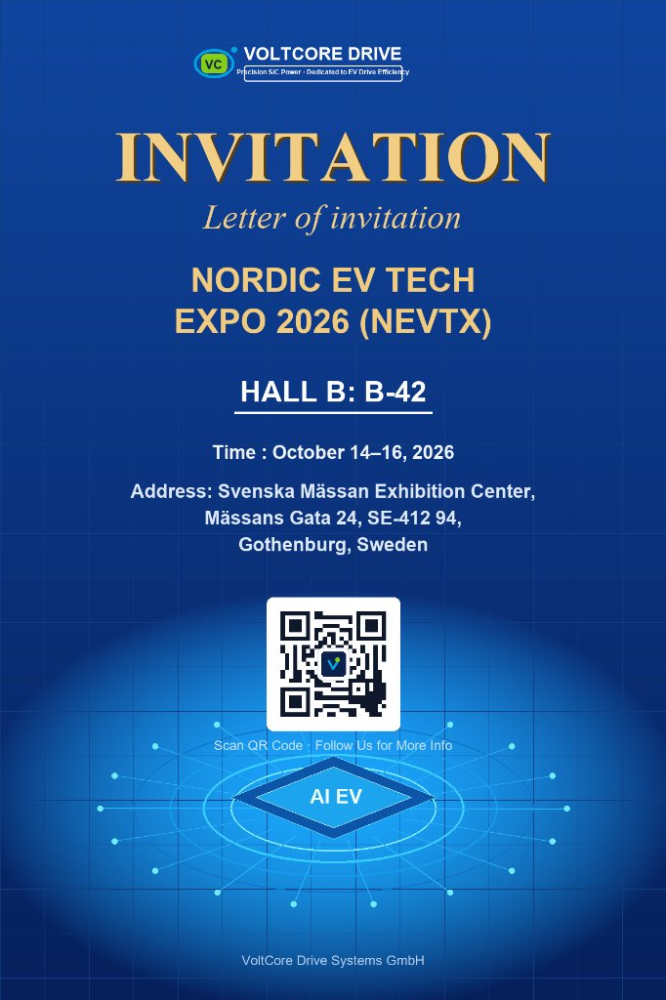
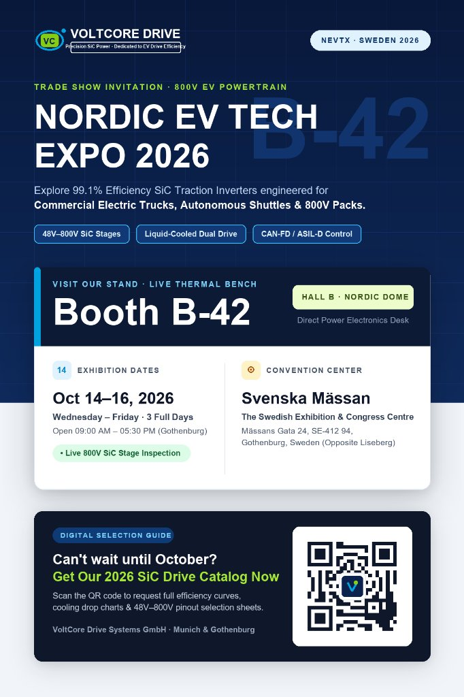
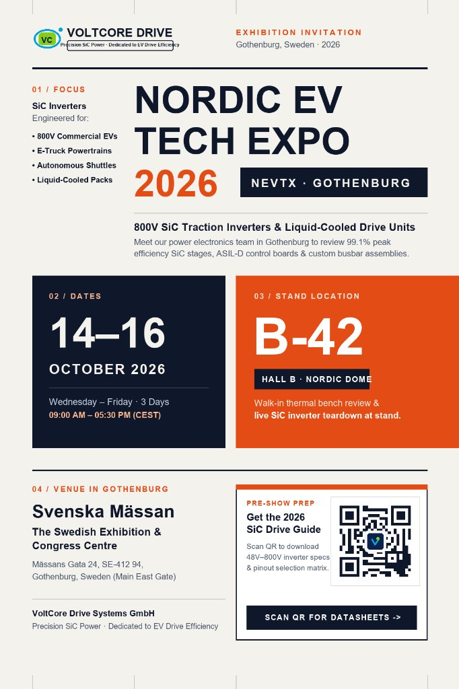
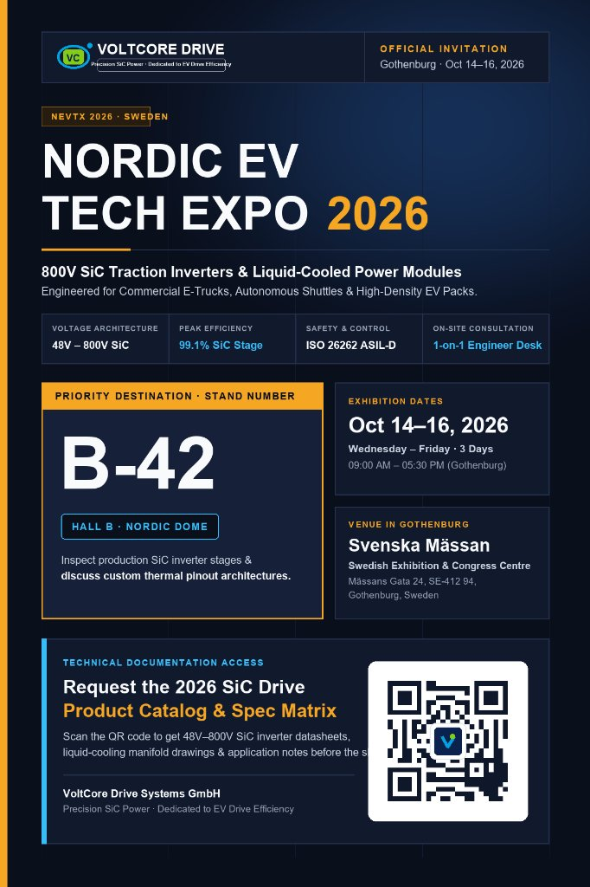
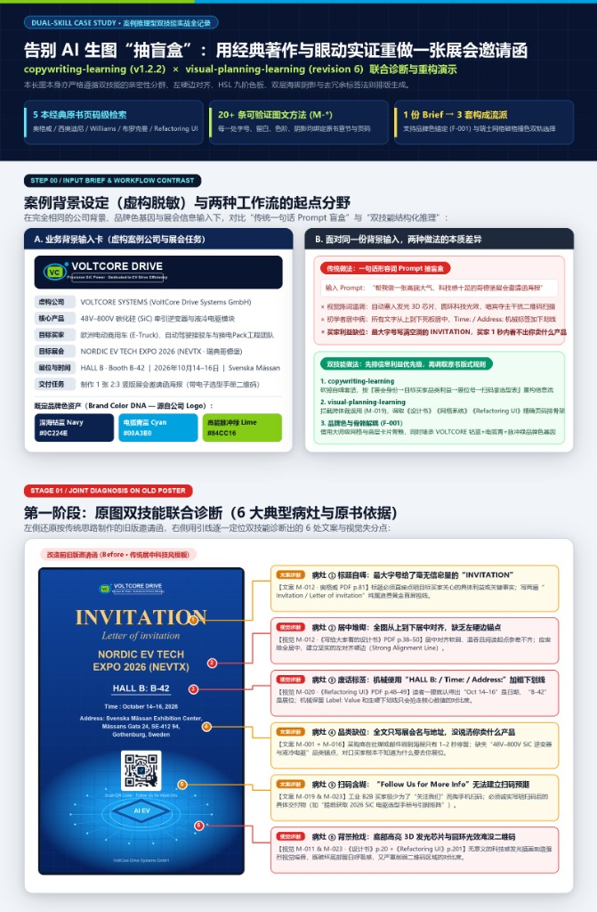
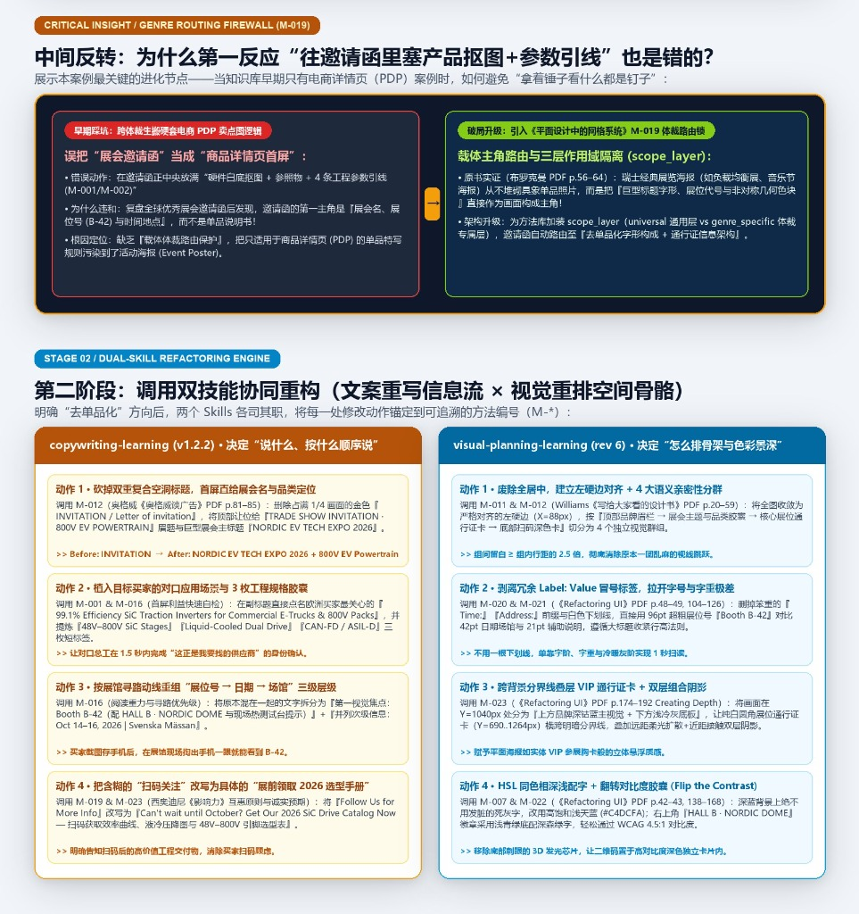
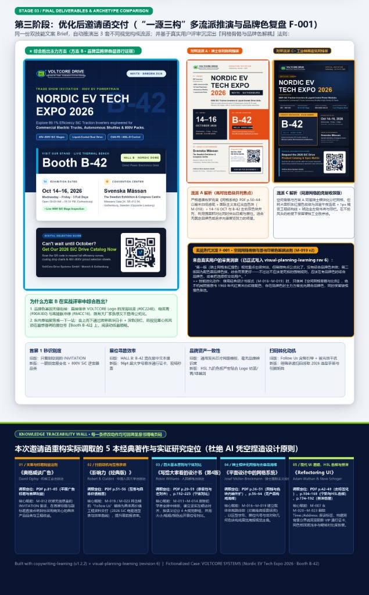

# visual-planning-learning

[简体中文说明](README.zh-CN.md) · [See it in action](#see-it-in-action) · [Library index](library/README.en.md) · [Get started](#get-started)

## Stop playing prompt roulette with AI layouts. Design from verified facts, eye-tracking evidence, and classic grid manuals.

When you ask an AI for *"a sleek, high-tech exhibition poster"* or *"a modern product page"*, you usually get glowing 3D clichés, dead-center text stacks, and invented product visuals. `visual-planning-learning` replaces vague aesthetic adjectives with **traceable layout reasoning**.

Grounded in eye-tracking UX benchmarks, classic typography/grid books, and live comparative field teardowns, this skill helps your agent diagnose why a visual fails, map confirmed product facts into concrete visual elements, enforce image-copy synergy, and generate structured art direction or multi-archetype layout options.

**v1.2.0 · `catalog.json` `r10` · 15 verified sources · 28 searchable visual methods (`M-001`–`M-028`) · 23 bilingual case cards (`en` + `zh`)**

[Explore the English library](library/README.en.md) · [中文案例与方法索引](library/README.md) · [Searchable catalog](library/catalog.json) · [Pairs with `copywriting-learning`](https://github.com/XavierCrea/copywriting-learning)

---

## See it in action

### Rebuilding a B2B trade-show invitation: `copywriting-learning` × `visual-planning-learning`

**The brief (fictionalized B2B case):** *VoltCore Drive Systems GmbH* needs a 2:3 vertical exhibition invitation for **Nordic EV Tech Expo 2026** (Gothenburg, Oct 14–16, **Booth B-42**), targeting European commercial e-truck and autonomous shuttle engineers evaluating **48V–800V SiC traction inverters**. Existing brand DNA from the logo: Navy (`#0C224E`), Electric Cyan (`#00A3E0`), and Pulse Lime (`#84CC16`).

#### 01 · Before vs. After (Same facts, different workflow)

| Before · Generic *"high-tech invitation"* prompt | After · Dual-skill primary deliverable (Option B · Brand-Aligned VIP Pass) |
| :---: | :---: |
|  |  |
| **6 diagnosed flaws:**<br>• Biggest type wasted on empty `"INVITATION / Letter of invitation"` (`M-012`)<br>• Weak all-center stacking with no left alignment axis (`M-012`)<br>• Mechanical `HALL B:` / `Time :` / `Address:` labels + underlines (`M-020`)<br>• Zero product/category signal — buyers can't tell what you sell (`M-001`)<br>• Vague `"Follow Us for More Info"` QR prompt (`M-019` / `M-023`)<br>• Glowing `"AI EV"` chip graphic competes with the QR code (`M-011` / `M-023`) | **What changed (every move traced to a method & page):**<br>• **1-second category hook:** Expo name + `99.1% Efficiency SiC Traction Inverters` + 3 spec pills above the fold<br>• **Strong left axis + 4 proximity groups:** Header → Headline & specs → Floating `Booth B-42` VIP pass → Dark QR card (`M-011`, `M-012`)<br>• **De-labeled hierarchy + dual-layer elevation:** Oversized `Booth B-42` + clean date/venue split (`M-020`, `M-023`)<br>• **Concrete QR incentive:** *"Can't wait until October? Get Our 2026 SiC Drive Catalog Now"*<br>• **Brand DNA preserved:** Inherits logo Navy/Cyan/Lime (`F-001`) |

#### 02 · The mid-task plot twist: Why *"add a product cutout + callout arrows"* was also wrong

Early in the test, the agent's first instinct was to apply e-commerce PDP rules (`M-001` / `M-002`) and drop a white-background hardware cutout with spec arrows into the middle of the invitation.

Comparing real-world Swiss exhibition posters (*Josef Müller-Brockmann*, *Grid Systems*, pp. 56–64) revealed the flaw: **a trade-show invitation is an event poster, not a product spec sheet.** Its primary visual protagonist is the **expo name, booth number (`B-42`), date, and venue** — not a product cutout. That insight produced **`M-019` (Genre Routing Firewall & `scope_layer`)**, separating `universal` layout principles from `genre_specific` PDP rules so the skill never misapplies e-commerce habits to event posters.

#### 03 · One brief → Three visual archetypes (plus feedback lesson `F-001`)

From the exact same dual-skill brief, `visual-planning-learning` explores **three distinct layout archetypes** so teams can choose intentionally instead of regenerating blindly:

| Option B · Brand-Aligned VIP Pass *(Primary)* | Option A · Swiss Asymmetric Grid | Option C · Dark Industrial Grid |
| :---: | :---: | :---: |
|  |  |  |
| Inherits VoltCore's Navy / Cyan / Lime palette; floating white pass card locks visual focus onto `Booth B-42`. | Warm cream paper stock + high-contrast navy & vermilion blocks (`M-016`–`M-018`); ideal when no strict brand palette exists. | Restrained dark engineering console with 4-column spec strip + amber priority frame for `B-42`. |

> **Captured in `F-001` (`M-019 v2`):** User review noted that Option A's Swiss grid stood out sharply, yet Option B won overall because it respected the existing logo's colors. That feedback was written back into the library: *borrow classic grid skeletons and proportions, never blindly overwrite an existing brand palette with 1950s poster colors.*

<details>
<summary>View the full 3-part annotated case study walkthrough (Chinese visual breakdown)</summary>







</details>

<details>
<summary>Try a similar task yourself (copyable prompt)</summary>

```text
Use visual-planning-learning (paired with copywriting-learning) to redesign this B2B trade-show invitation.
Product & confirmed facts: [48V–800V SiC traction inverters, 99.1% peak efficiency, ISO 26262 ASIL-D]
Event details: [Nordic EV Tech Expo 2026, Oct 14–16, Hall B / Booth B-42, Svenska Mässan, Gothenburg]
Brand colors from logo: [Navy #0C224E, Cyan #00A3E0, Lime #84CC16]
Deliverable: 2:3 vertical invitation with QR code to download the 2026 SiC Drive Catalog.
Diagnose any draft flaws first, check genre routing (M-019), and propose 2–3 distinct visual archetypes grounded in library methods.
```

</details>

---

## Five ways to put it to work

1. **Product Detail Page (PDP) Storyboards** — Build screen-by-screen visual briefs anchored by real assets: In-Scale references (`M-001`), descriptive callouts (`M-002`), included vs. optional accessories (`M-003`), and zero unverified claims.
2. **Landing Page Hero & Pricing Diagnosis** — Fix abstract hero illustrations (`M-004`), 60-mph billboard visual noise (`M-024`), weak hierarchy (`M-020`), and pricing anchor framing (`M-009`).
3. **B2B Technical Spec Sheets & Catalogs** — Turn unreadable *"walls of specs"* into scannable modular grids (`M-005`, `M-018`, `M-021`) without hiding key sections behind horizontal tabs (`M-006`).
4. **Trade-Show Invitations, Posters & Booths** — Apply genre-aware typographic composition (`M-019`), `170 cm` exhibition eye-level grids, and brand-DNA color decoupling (`F-001`).
5. **Live Field Teardowns & Book Dissections** — Bring a real outdoor billboard photo, a competitor redesign, or a design book chapter; dissect it with the 5-step anatomy workflow, separate observation from conversion claims, and patch it into your bilingual library (`library.py apply-patch`).

---

## What's Inside the Library (`catalog.json` `r10`)

Every record explicitly tags its `learning_origin` (`book_canon`, `benchmark_study`, `co_dissected_teardown`, or `task_feedback`) so live user–agent teardowns are clearly separated from seeded books and UX studies.

| Source Category (`learning_origin`) | Reviewed Works & Field Teardowns (`15` Sources, `100%` Full Review) | Methods (`28`) & Bilingual Cases (`23` `zh` + `23` `en`) |
| :--- | :--- | :--- |
| **[Live Co-Dissected] Comparative Field Teardowns (`co_dissected_teardown`)** | **2026 New Xiaomi SU7 × Shu Qi "Capri Blue" Mall Billboards vs. Competitor Outdoor LEDs (Genesis, Voyah Taishan, Denza N9, XPeng X9, Buick, Geely, Avatr)**: 3-question inquiry chain + 6-dimensional street-photo teardown | `M-028` (`validated`) · `1` bilingual case card (`C-xiaomi-su7-2026-mall-billboard-teardown`) + `F-002` |
| **Baymard Institute UX Benchmarks (`benchmark_study`)** | `5` large-scale eye-tracking & usability studies on In-Scale images, Descriptive Callouts, Included/Optional Accessories, Spec Sheet Scannability, and Horizontal Tabs | `M-001`–`M-003`, `M-005`–`M-006` · `5` bilingual case cards (`C-baymard-*`) |
| **Marketing Examples (Harry Dry)** | `4` landing page, pricing & brand teardowns (Above-the-Fold Guide, Rows' Live Spreadsheet A/B Test & Haako Rewrite, Refactoring UI `$149` Tier & Basecamp `$99` Anchor, Tropicana `$55M` Rebrand Loss & Angostura Bitters) | `M-004`, `M-009`–`M-010` · `4` bilingual case cards (`C-me-*`) |
| **Robin Williams — *The Non-Designer's Design Book (4th Ed.)*** | Complete 258-page review: CRAP principles (*Proximity*, *Alignment*, *Repetition*, *Contrast*), 12-Part Color Wheel (*Shades/Tints*, *Value*, *Cool Recedes / Warm Advances*), and Typography (*Concord, Conflict, and Contrast*, `giraffe` vs. `GIRAFFE` word coastlines) | `M-011`–`M-015` · `3` bilingual case cards (`C-williams-*`) |
| **Josef Müller-Brockmann — *Grid systems in graphic design*** | Complete 85-page review: `1 : 1.5 : 2 : 3` progressive margins, baseline modular grids (`55 lines = 4 × 13 + 3`), `8/20/32-field` matrices, Figs. 1–4 *"Coloured areas in the grid system"*, Swiss typographic posters (*"musica viva"*), `30-field` B2B burner manual, and `170 cm` 3D booth eye-level grids | `M-016`–`M-019` · `3` bilingual case cards (`C-muller-brockmann-*`) |
| **Adam Wathan & Steve Schoger — *Refactoring UI*** | Complete 252-page book + *7 Practical Tips*: Color/weight hierarchy, same-hue dark-bg text, borderless spacing, de-labeling vs. spec-sheet label emphasis, `6`-to-`4` col rich tables, `≥25%` spacing scale, `45–75 char` measure, `100–900` HSL ramps with perceived-brightness hue rotation, flipped WCAG `4.5:1` contrast, dual shadows, and monochrome `multiply` hero contrast | `M-007`–`M-008`, `M-020`–`M-023` · `4` bilingual case cards (`C-refactoring-ui-*`) |
| **Steve Krug — *Don't Make Me Think, Revisited (3rd Ed.)*** | Complete 257-page review: First Law (*"Don't make me think!"*), 60-mph scanning/satisficing, *Billboard Design 101*, visual nesting, *"No cursor = no hover = no clue"*, 3 visual noises (**Shouting, Disorganization, Clutter**), Third Law (`103` → `34 words` pruning), `"You are here"` cues *"twice as prominent"*, 6-item **Trunk Test**, Homepage *Big Bang Theory* (`50ms`, `6–8 word` Tagline vs. Motto, *Tragedy of the Commons*), and *Reservoir of Goodwill* (**Candid FAQs** vs. `QWWPWAs`, ear-scanning) | `M-024`–`M-027` · `3` bilingual case cards (`C-krug-*`) |

---

## Get started

### Installation

Clone or download this repository into your agent's skills directory (keep the entire folder intact so `SKILL.md`, `references/`, `library/`, and `scripts/` stay together):

- **Antigravity (global):** `~/.gemini/config/skills/visual-planning-learning/`
- **Project / Codex (workspace-scoped):** `.agents/skills/visual-planning-learning/`

Python 3.9+ is required for `scripts/library.py` (standard library only — zero external dependencies).

### Quick Start & CLI Commands

Run commands from the skill root directory (`visual-planning-learning/`):

```bash
# 1. Inspect library summary and source coverage
python3 scripts/library.py summary

# 2. Search by visual symptom or keyword (supports English & Chinese)
python3 scripts/library.py search "wall of specs" --kind methods
python3 scripts/library.py search "billboard visual noise" --kind cases
python3 scripts/library.py search "in-scale size" --channel pdp

# 3. Batch-get multiple methods and cases in one call (returns both zh and en markdown paths)
python3 scripts/library.py get M-001 M-020 M-024 C-krug-billboard-scanning-and-visual-noise

# 4. Validate schema, cross-references, bilingual markdown files, and SHA-256 digests
python3 scripts/library.py validate --check-files
```

---

## Pairing with `copywriting-learning`

`visual-planning-learning` works standalone or in tandem with [`copywriting-learning`](https://github.com/XavierCrea/copywriting-learning):

- **[`copywriting-learning`](https://github.com/XavierCrea/copywriting-learning)** decides *what to say, in what sequence, and with what proof*;
- **`visual-planning-learning`** decides *what physical evidence the camera or layout shows, how items are grouped and aligned on the grid, where leader lines/captions sit, and how hierarchy guides a 60-mph scanner*.
