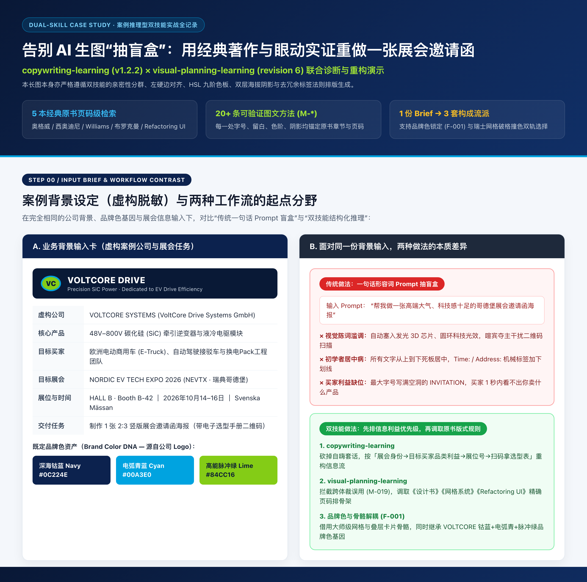
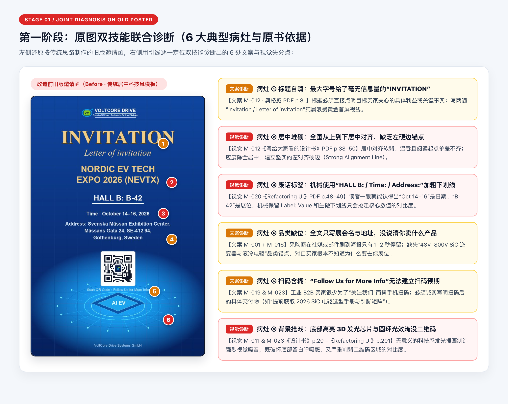
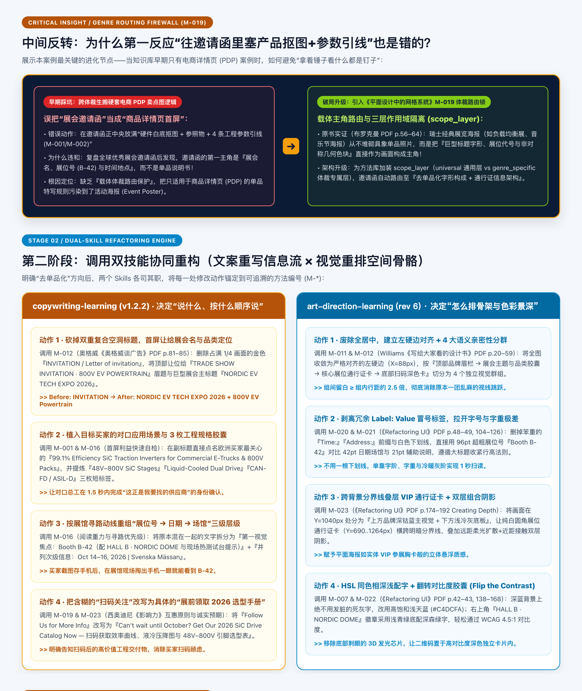
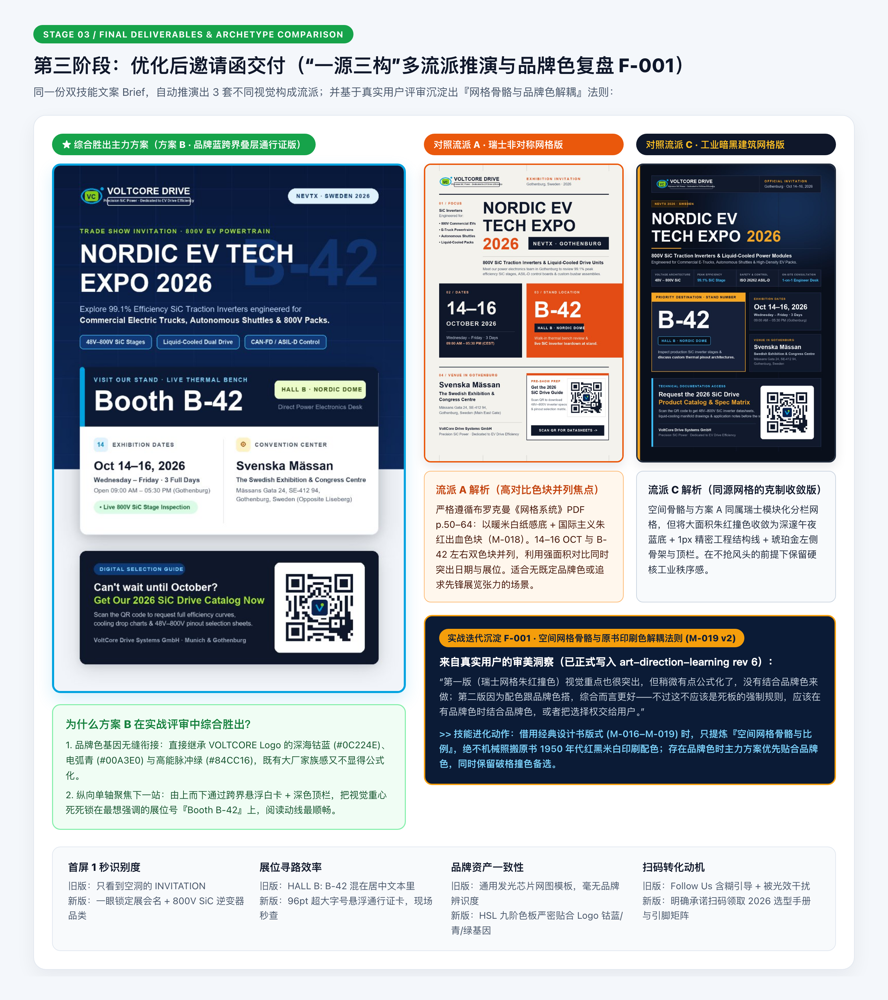
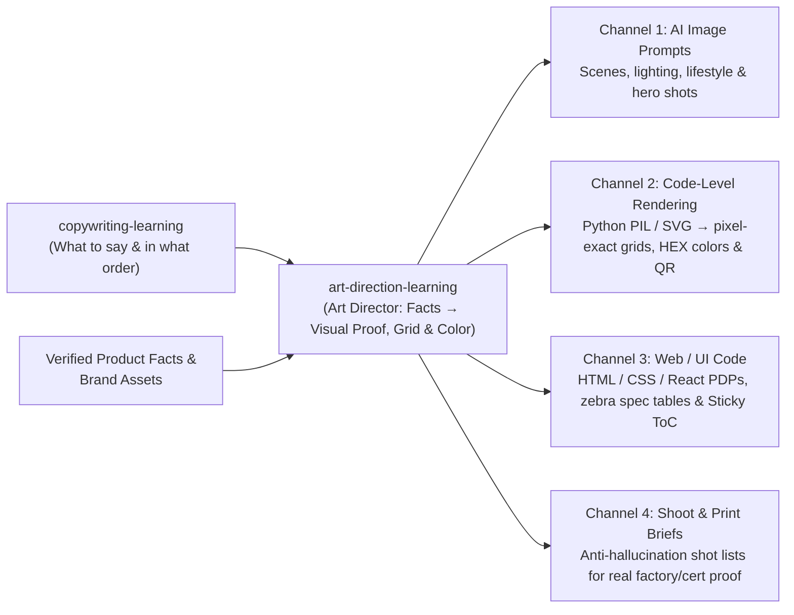

# art-direction-learning

[简体中文说明](README.zh-CN.md) · [See it in action](#see-it-in-action) · [How it works](#how-it-works) · [Who is this for](#who-is-this-for) · [Library index](library/README.en.md) · [Get started](#get-started)

## Stop playing prompt roulette with AI layouts. Give your agent an Art Director grounded in eye-tracking research and classic design books.

`art-direction-learning` is **not** a prompt wrapper for image generators. It is an upstream **Art Director / Visual Director** skill that first decides *what buyer decision a screen must support, what physical proof belongs in frame, how grids/spacing/color scales work, and what clutter to cut* — then routes the output into **4 distinct execution channels** (AI image prompts, pixel-exact Python/SVG rendering, responsive HTML/React code, or adjective-free photography briefs).

**v1.5.0 · `catalog.json` `r17` · 23 verified sources · 39 visual methods (`M-001`–`M-039`) · 34 bilingual case cards (`en` + `zh`) · 7 verified style archetypes + 6 composable pattern groups + Objective Output QA Gate**

[Explore the English library](library/README.en.md) · [中文案例与方法索引](library/README.md) · [Style Archetypes](library/styles/README.md) · [Poster Patterns](references/poster-patterns.md) · [Output QA Gate](references/output-qa-gate.md) · [Pairs with `copywriting-learning`](https://github.com/XavierCrea/copywriting-learning)

---

## See it in action

### Rebuilding a B2B trade-show invitation: `copywriting-learning` × `art-direction-learning`

**The brief (fictionalized B2B case):** *VoltCore Drive Systems GmbH* needs a 2:3 vertical exhibition invitation for **Nordic EV Tech Expo 2026** (Gothenburg, Oct 14–16, **Booth B-42**), targeting European commercial e-truck and autonomous shuttle engineers evaluating **48V–800V SiC traction inverters**. Existing brand DNA from the logo: Navy (`#0C224E`), Electric Cyan (`#00A3E0`), and Pulse Lime (`#84CC16`).

#### 01 · Before vs. After (Same facts, different workflow)

| Before · Generic *"high-tech invitation"* prompt | After · Dual-skill primary deliverable (Option B · Brand-Aligned VIP Pass) |
| :---: | :---: |
|  |  |
| **6 diagnosed flaws:**<br>• Biggest type wasted on empty `"INVITATION / Letter of invitation"` (`M-012`)<br>• Weak all-center stacking with no left alignment axis (`M-012`)<br>• Mechanical `HALL B:` / `Time :` / `Address:` labels + underlines (`M-020`)<br>• Zero product/category signal — buyers can't tell what you sell (`M-001`)<br>• Vague `"Follow Us for More Info"` QR prompt (`M-019` / `M-023`)<br>• Glowing `"AI EV"` chip graphic competes with the QR code (`M-011` / `M-023`) | **What changed (every move traced to a method & page):**<br>• **1-second category hook:** Expo name + `99.1% Efficiency SiC Traction Inverters` + 3 spec pills above the fold<br>• **Strong left axis + 4 proximity groups:** Header → Headline & specs → Floating `Booth B-42` VIP pass → Dark QR card (`M-011`, `M-012`)<br>• **De-labeled hierarchy + dual-layer elevation:** Oversized `Booth B-42` + clean date/venue split (`M-020`, `M-023`)<br>• **Concrete QR incentive:** *"Can't wait until October? Get Our 2026 SiC Drive Catalog Now"*<br>• **Brand DNA preserved:** Inherits logo Navy / Cyan / Lime (`F-001`) |

#### 02 · The mid-task plot twist: Why *"add a product cutout + callout arrows"* was also wrong

Early in the test, the agent's first instinct was to apply e-commerce PDP rules (`M-001` / `M-002`) and drop a white-background hardware cutout with spec arrows into the middle of the invitation.

Cross-checking Swiss exhibition posters (*Josef Müller-Brockmann*, *Grid Systems*, pp. 56–64) exposed the mistake: **a trade-show invitation is an event poster, not a product spec sheet.** Its primary visual protagonist is the **expo name, booth number (`B-42`), date, and venue** — not a product cutout. That insight produced **`M-019` (Genre Routing Firewall & `scope_layer`)**, separating `universal` layout principles from `genre_specific` PDP rules so the skill never misapplies e-commerce habits to event posters.

#### 03 · One brief → Three visual archetypes (plus feedback lesson `F-001`)

From the exact same dual-skill brief, `art-direction-learning` explores **three distinct layout archetypes** so teams choose intentionally instead of regenerating blindly:

| Option B · Brand-Aligned VIP Pass *(Primary)* | Option A · Swiss Asymmetric Grid | Option C · Dark Industrial Grid |
| :---: | :---: | :---: |
|  |  |  |
| Inherits VoltCore's Navy / Cyan / Lime palette; floating white pass card locks visual focus onto `Booth B-42`. | Warm cream paper stock + high-contrast navy & vermilion blocks (`M-016`–`M-018`); ideal when no strict brand palette exists. | Restrained dark engineering console with 4-column spec strip + amber priority frame for `B-42`. |

> **Captured in `F-001` (`M-019 v2`):** User review noted that Option A's Swiss grid stood out sharply, yet Option B won overall because it respected the existing logo's colors. That feedback was written back into the library: *borrow classic grid skeletons and proportions, never blindly overwrite an existing brand palette with 1950s poster colors.*

<details>
<summary>View the full 5-card HD annotated case study walkthrough (Chinese breakdown, 2560px Retina PNGs)</summary>










</details>

<details>
<summary>Try a similar task yourself (copyable prompt)</summary>

```text
Use art-direction-learning (paired with copywriting-learning) to redesign this B2B trade-show invitation.
Product & confirmed facts: [48V–800V SiC traction inverters, 99.1% peak efficiency, ISO 26262 ASIL-D]
Event details: [Nordic EV Tech Expo 2026, Oct 14–16, Hall B / Booth B-42, Svenska Mässan, Gothenburg]
Brand colors from logo: [Navy #0C224E, Cyan #00A3E0, Lime #84CC16]
Deliverable: 2:3 vertical invitation with QR code to download the 2026 SiC Drive Catalog.
Diagnose any draft flaws first, check genre routing (M-019), and propose 2–3 distinct visual archetypes grounded in library methods.
```

</details>

---

## How it works

### 1. One Art Director Brain → Four Downstream Execution Channels



| Channel | Best For | Why This Channel Exists |
| :--- | :--- | :--- |
| **1. AI Image Gen / Edit Prompts** | Atmospheric scenes, lifestyle context, lighting & hero compositions | Pairs with `image-prompt-guide` once buyer proof, scale reference (`M-001`), and focal hierarchy are locked. |
| **2. Precision Code Rendering (`Python PIL` / `SVG`), Direct Photo Layout & Hybrid** | Direct layout on quality original/venue photos, graphic invitations, Swiss grids, comparison charts, and vector typography | Solves AI generators' 4 classic failures: broken modular grids (`M-016`), drifting HEX codes, garbled small text, and broken QR codes. When a strong original venue or studio photo already exists, use **Channel 0 direct photo layout** (crop, grade, set type); when compositing products, follow [Output QA Gate](references/output-qa-gate.md) to pick among matching-background swap, reshoot/relight, color-matched compositing, or AI relighting + label patching while verifying hardware ports and geometry. |
| **3. Interactive Web Code (`HTML` / `CSS` / `React`)** | B2B storefronts (e.g., Alibaba International), landing pages, interactive spec tables | Half of UX layout science — single-column zebra spec sheets (`M-005`), vertical expansion over hidden horizontal tabs (`M-006`), borderless spacing (`M-007`) — requires real code, not flat JPEGs. |
| **4. Photography & Retouching Briefs** | Factory test benches, real UL/CE certificates, included wiring-harness flat-lays (`M-003`) | **Strict anti-hallucination guardrail:** never let AI fabricate hardware internals, lab curves, or certificates. Outputs adjective-free camera angles, scale props, and callout coordinates. |

### 2. Cross-Distance Spatial Relay (`100m → 10m → 1m`)

For offline exhibitions and commercial spaces, the skill orchestrates visual density across viewing distances (`M-019` + `M-028`):

| Distance | Touchpoint | Visual Strategy | What Gets Ruthlessly Cut |
| :--- | :--- | :--- | :--- |
| **`100m`** | Parking-lot mega-poster / mall exterior LED (`M-028`) | 1.5-second glance: `≥75%` single high-chroma brand color field to slice through clutter + short category/emotion hook + 6× oversized booth number | Spec tables, multi-grid pricing, footnotes, QR codes |
| **`10m`** | Booth fascia / `170 cm` eye-level main backdrop (`M-019`) | Locks the exact same brand color as the `100m` poster for instant cross-space recall; anchors core positioning at `170 cm` standing eye level | Low-placed copy blocked by crowds or counters |
| **`1m`** | Tabletop selection sheet / online PDP (`M-001`–`M-005`, `M-020`) | Closes technical buyers with In-Scale photos, descriptive callouts, zebra-striped spec tables, and verified certification proof | Vague slogans without measurable engineering specs |

---

## Who is this for

| Role | Real-World Pain Point | How You Use `art-direction-learning` | Primary Channels |
| :--- | :--- | :--- | :--- |
| **Cross-Border & B2B E-Commerce Sellers / Operators** *(Alibaba, Amazon, DTC)* | PDPs look like an unreadable wall of specs, buyers misjudge product size or included accessories, and AI image tools keep hallucinating fake parts/certs. | Generate screen-by-screen PDP storyboards (`M-001`–`M-006`), real photography shot lists, and responsive single-column zebra spec tables. | Channels 1, 3, 4 |
| **Brand & Trade-Show Marketers** | Invitations, parking-lot billboards, and booth backdrops look dated or disconnected — and get swallowed by surrounding visual noise. | Run *"One Brief → Three Archetypes"* for invitations (`M-019`, `F-001`) and coordinate `100m → 10m → 1m` exhibition relays (`M-028`). | Channels 2, 4 |
| **Designers, Art Directors & Visual Planners** | Tired of vague revision feedback (*"make it more high-tech / premium"*) and endless subjective debates with stakeholders. | Back every layout proposal with Baymard eye-tracking benchmarks, Müller-Brockmann grid math, and *Refactoring UI* page citations; deliver 2–3 structured angles fast. | Channels 1, 2, 4 |
| **Indie Makers, PMs & Growth Teams** | No dedicated designer on staff; landing page heroes, pricing tiers, and comparison tables feel cluttered or fail the 5-second clarity test. | Diagnose visual noise (*Don't Make Me Think* `M-024`–`M-027`), fix pricing anchors (`M-009`), and compile clean HTML/CSS/React layouts (`M-020`–`M-023`). | Channel 3 |
| **AI Workflow & Agent Skill Builders** | Static mega-prompts bloat over time and can't evolve from real-world wins or mistakes. | Use the 4-tier `learning_origin` provenance schema + `apply-patch` atomic updates to turn live field teardowns and user feedback into a searchable bilingual library. | All + CLI |

---

## What's Inside the Library (`catalog.json` `r17`)

Every record explicitly tags its **`learning_origin`** (`book_canon`, `benchmark_study`, `co_dissected_teardown`, or `task_feedback`) so live user–agent teardowns are clearly separated from seeded books and UX studies — and can be filtered directly via `--origin`.

| Source Category (`learning_origin`) | Reviewed Works & Field Teardowns (`23` Sources) | Methods (`39`) & Bilingual Cases (`34` `zh` + `34` `en`) |
| :--- | :--- | :--- |
| **[Live Co-Dissected] Comparative Field Teardowns (`co_dissected_teardown`)** | **2026 New Xiaomi SU7 × Shu Qi "Capri Blue" Mall Billboards vs. Competitor Outdoor LEDs (Genesis, Voyah Taishan, Denza N9, XPeng X9, Buick, Geely, Avatr)**: 3-question inquiry chain + 6-dimensional street-photo teardown | `M-028` (`validated`) · `1` bilingual case card (`C-xiaomi-su7-2026-mall-billboard-teardown`) + `F-002` |
| **Modern Social Feeds, Carousels & Mobile Ergonomics (`benchmark_study`)** | **Laws of UX** (`lawsofux.com`, 9 net-new cognitive principles), **TikTok Creative Center** (`1080×1920` pixel Safe Zones & 2–3s visual hooks), and **Motion Performance Creative Benchmarks** (TSR diagnostic ladder, *Us vs. Them* & native static ads) | `M-029`–`M-034` · `6` bilingual case cards (`C-lawsofux-*`, `C-tiktok-*`, `C-motion-*`) |
| **Modern OOH & Print Poster Craft (`benchmark_study` · `editorial_analysis`)** | **Ads of the World & Famous Campaigns** live-inspected campaigns: **Three Seven Paris** (*How much do you love her?*, physical-scale price ladder), **Fnac** (*Another Addiction is Possible*, visual double-take & single light-cone), **Muserk** (*Get F'in Paid*, 60% condensed typographic wall + corner QR), **Mercedes-Benz** (*Rollover Sensor*, 4-frame icon-as-diagram state sequence & whisper reveal), and **Coca-Cola** (*Recycle Me*, crushed-can symbol deformation + 95% monochrome color-field minimalism) | `M-035`–`M-039` · `5` bilingual case cards (`C-aotw-*`, `C-coca-cola-*`) |
| **Baymard Institute UX Benchmarks (`benchmark_study`)** | `5` large-scale eye-tracking & usability studies on In-Scale images, Descriptive Callouts, Included/Optional Accessories, Spec Sheet Scannability, and Horizontal Tabs | `M-001`–`M-003`, `M-005`–`M-006` · `5` bilingual case cards (`C-baymard-*`) |
| **Marketing Examples (Harry Dry)** | `4` landing page, pricing & brand teardowns (Above-the-Fold Guide, Rows' Live Spreadsheet A/B Test & Haako Rewrite, Refactoring UI `$149` Tier & Basecamp `$99` Anchor, Tropicana `$55M` Rebrand Loss & Angostura Bitters) | `M-004`, `M-009`–`M-010` · `4` bilingual case cards (`C-me-*`) |
| **Robin Williams — *The Non-Designer's Design Book (4th Ed.)*** | Complete 258-page review: CRAP principles (*Proximity*, *Alignment*, *Repetition*, *Contrast*), 12-Part Color Wheel (*Shades/Tints*, *Value*, *Cool Recedes / Warm Advances*), and Typography (*Concord, Conflict, and Contrast*, `giraffe` vs. `GIRAFFE` word coastlines) | `M-011`–`M-015` · `3` bilingual case cards (`C-williams-*`) |
| **Josef Müller-Brockmann — *Grid systems in graphic design*** | Complete 85-page review: `1 : 1.5 : 2 : 3` progressive margins, baseline modular grids (`55 lines = 4 × 13 + 3`), `8/20/32-field` matrices, Figs. 1–4 *"Coloured areas in the grid system"*, Swiss typographic posters (*"musica viva"*), `30-field` B2B burner manual, and `170 cm` 3D booth eye-level grids | `M-016`–`M-019` · `3` bilingual case cards (`C-muller-brockmann-*`) |
| **Adam Wathan & Steve Schoger — *Refactoring UI*** | Complete 252-page book + *7 Practical Tips*: Color/weight hierarchy, same-hue dark-bg text, borderless spacing, de-labeling vs. spec-sheet label emphasis, `6`-to-`4` col rich tables, `≥25%` spacing scale, `45–75 char` measure, `100–900` HSL ramps with perceived-brightness hue rotation, flipped WCAG `4.5:1` contrast, dual shadows, and monochrome `multiply` hero contrast | `M-007`–`M-008`, `M-020`–`M-023` · `4` bilingual case cards (`C-refactoring-ui-*`) |
| **Steve Krug — *Don't Make Me Think, Revisited (3rd Ed.)*** | Complete 257-page review: First Law (*"Don't make me think!"*), 60-mph scanning/satisficing, *Billboard Design 101*, visual nesting, *"No cursor = no hover = no clue"*, 3 visual noises (**Shouting, Disorganization, Clutter**), Third Law (`103` → `34 words` pruning), `"You are here"` cues *"twice as prominent"*, 6-item **Trunk Test**, Homepage *Big Bang Theory* (`50ms`, `6–8 word` Tagline vs. Motto, *Tragedy of the Commons*), and *Reservoir of Goodwill* (**Candid FAQs** vs. `QWWPWAs`, ear-scanning) | `M-024`–`M-027` · `3` bilingual case cards (`C-krug-*`) |

---

## Get started

### Installation

Clone or download this repository into your agent's skills directory (keep `SKILL.md`, `references/`, `library/`, and `scripts/` together):

- **Antigravity (global):** `~/.gemini/config/skills/art-direction-learning/`
- **Project / Codex (workspace-scoped):** `.agents/skills/art-direction-learning/`

Python 3.9+ is required for `scripts/library.py` (standard library only — zero external dependencies).

### Quick Start & CLI Commands

Run commands from the skill root directory (`art-direction-learning/`):

```bash
# 1. Inspect library summary and source coverage
python3 scripts/library.py summary

# 2. Search by visual symptom, channel, or provenance origin (supports English & Chinese)
python3 scripts/library.py search "wall of specs" --kind methods
python3 scripts/library.py search "billboard visual noise" --kind cases
python3 scripts/library.py search "mall billboard color field" --origin co_dissected_teardown

# 3. Batch-get multiple methods and cases in one call (returns both zh and en markdown paths)
python3 scripts/library.py get M-001 M-019 M-028 C-xiaomi-su7-2026-mall-billboard-teardown

# 4. Validate schema, cross-references, bilingual markdown files, and SHA-256 digests
python3 scripts/library.py validate --check-files
```

### Pairing with `copywriting-learning`

`art-direction-learning` works standalone or in tandem with [`copywriting-learning`](https://github.com/XavierCrea/copywriting-learning):

- **[`copywriting-learning`](https://github.com/XavierCrea/copywriting-learning)** decides *what to say, in what sequence, and with what proof*;
- **`art-direction-learning`** decides *what physical evidence the camera or layout shows, how items align on the grid, which of the 4 delivery channels to use, and how `100m → 10m → 1m` touchpoints hand off to each other*.
