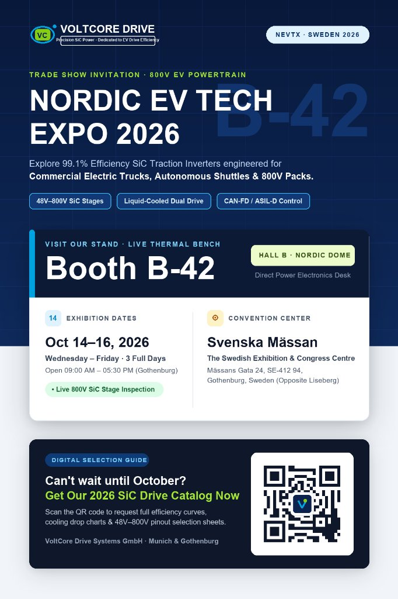
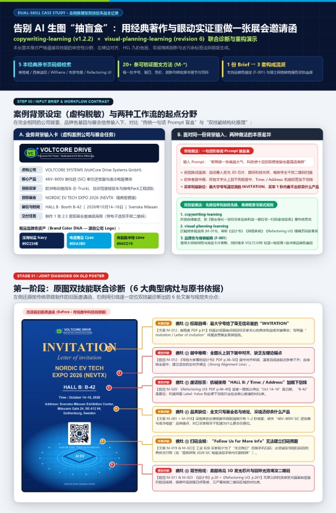
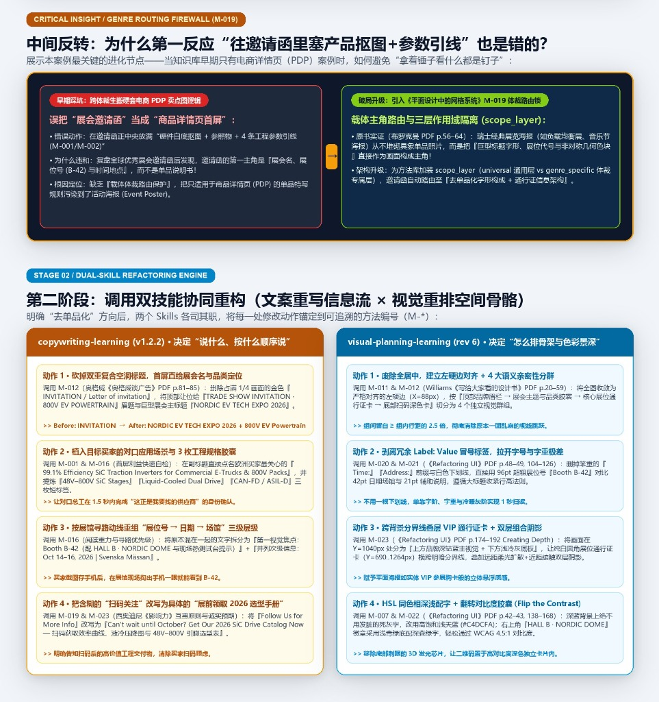
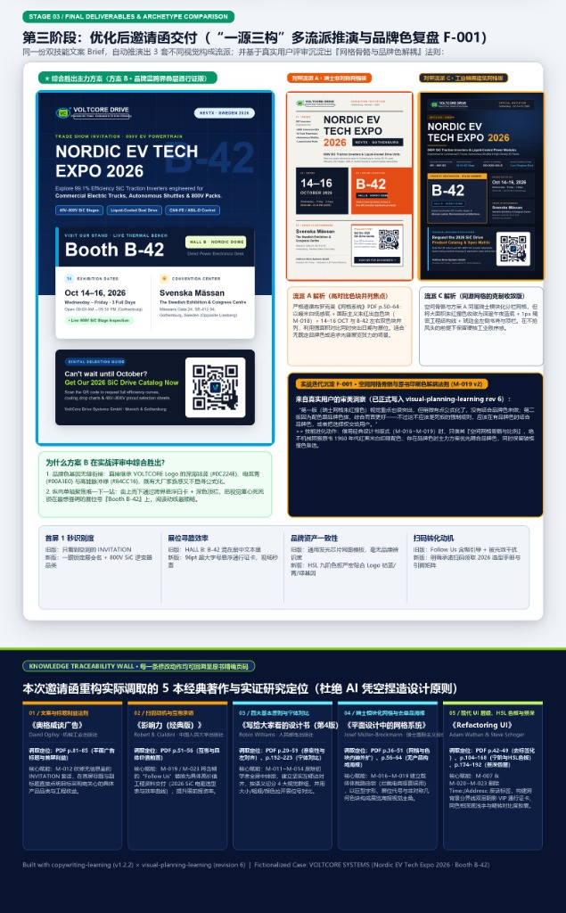
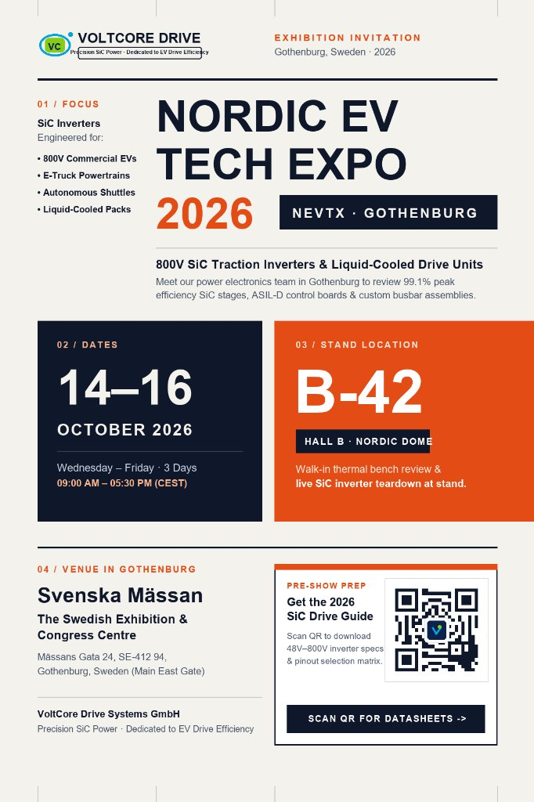
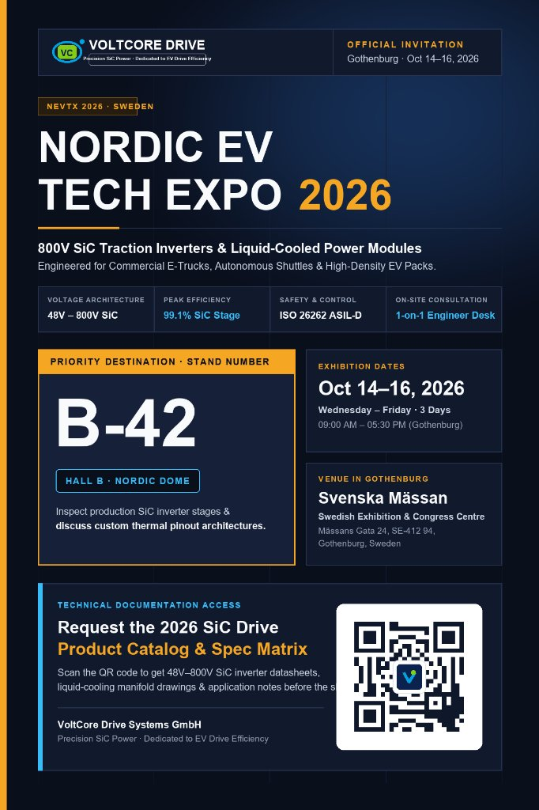

# visual-planning-learning · 视觉策划与案例学习技能包

[English README](README.md) · [实战对比演示](#实战演示双技能重做一张-b2b-展会邀请函) · [中文案例与方法索引](library/README.md) · [快速上手](#快速上手)

## 告别 AI 生图与排版的“抽盲盒”：用产品事实、眼动实证与经典原著做视觉策划

当你只对 AI 说“帮我做一张高端大气、科技感十足的海报/详情页”时，得到的往往是发光 3D 芯片、通篇死板居中、以及脱离产品事实的空洞画面。`visual-planning-learning` 彻底拒绝“大气、高端、高级感”这类空泛形容词，让 Agent 的每一次构图、留白、配色与层级决策都有可追溯的**方法编号（`M-*`）与原书页码依据**。

本技能包基于眼动追踪 UX 实验、四大设计/可用性经典原著与街头实拍共创拆解，支持按**视觉卡点症状（`when_stuck`）**检索方法与案例，覆盖**电商详情页分镜（PDP Storyboard）、着陆页首屏（Hero）、B2B 工业参数表与选型册、展会邀请函与展台立面、以及广告构图诊断**。

**v1.2.0 · `catalog.json` `r10` · 15 项全量核验信源 · 28 条可检索视觉方法（`M-001`–`M-028`） · 23 篇中英双语案例卡**

[浏览中文案例索引](library/README.md) · [English Library Index](library/README.en.md) · [结构化双语目录](library/catalog.json) · [搭配 `copywriting-learning` 联动](https://github.com/XavierCrea/copywriting-learning)

---

## 实战演示：双技能重做一张 B2B 展会邀请函

以下展示同一份虚构 B2B 业务输入（*VoltCore Drive Systems GmbH* · 2026 瑞典哥德堡北欧电动车技术展 · 展位 `Booth B-42` · 48V–800V SiC 牵引逆变器），在 **“传统一句话 Prompt 抽盲盒”** 与 **“`copywriting-learning` × `visual-planning-learning` 双技能协同重构”** 下的真实产出对比：

### 首屏直观对比：Before vs. After（综合胜出主推稿）

| 改造前（Before · 传统居中科技风模板） | 改造后（After · 方案 B 品牌蓝跨界叠层通行证版） |
| :---: | :---: |
|  |  |
| **最大字号给空洞的 `INVITATION`、全居中无左硬边、没写清卖什么产品、底部发光 `AI EV` 芯片抢二维码视线。** | **1 秒锁定展会与 SiC 逆变器品类、悬浮白卡锁死 `Booth B-42`、明确扫码领 2026 选型手册、无缝承接 Logo 品牌三色。** |

---

### 完整三阶段重构全记录（原图诊断 → 中间反转 → 一源三构交付）

#### 第一阶段：业务输入对比 & 原图 6 大病灶联合诊断


#### 中间反转（`M-019` 体裁路由锁）& 第二阶段：双技能 4+4 协同重构


#### 第三阶段：“一源三构”多流派交付、品牌色复盘（`F-001`）与 5 本原著溯源墙


<details>
<summary>展开查看“一源三构” 3 套成稿高清原图并排对比 & 复现 Prompt</summary>

| 方案 B · 品牌蓝跨界叠层通行证（综合胜出主推） | 流派 A · 瑞士非对称网格版 | 流派 C · 工业暗黑建筑网格版 |
| :---: | :---: | :---: |
|  |  |  |

```text
请联合调用 copywriting-learning 和 visual-planning-learning，帮我重构一张 2:3 竖版 B2B 展会邀请函：
- 已知产品与事实：[48V–800V SiC 牵引逆变器、99.1% 峰值效率、ISO 26262 ASIL-D]
- 展会信息：[Nordic EV Tech Expo 2026，2026年10月14–16日，Hall B · Booth B-42，瑞典哥德堡 Svenska Mässan]
- 品牌 Logo 既有色：[深海钴蓝 #0C224E、电弧青蓝 #00A3E0、高能脉冲绿 #84CC16]
- 扫码交付物：[下载 2026 SiC 电驱选型手册与引脚矩阵]
要求：先诊断原稿问题，检查体裁路由（M-019），并基于知识库方法给出 2–3 套不同流派的视觉构图方案。
```

</details>

---

## 五大核心应用场景

1. **电商详情页分镜（PDP Storyboard）**：将产品物理事实转化为可拍摄/可绘制的分屏执行单，强制绑定比例参照图（`M-001`）、引线标注（`M-002`）与标配/选配附件图（`M-003`），杜绝凭空捏造结构与数据。
2. **着陆页首屏与定价区诊断**：快速定位首屏插画太虚（`M-004`）、60 英里扫视下的三大视觉噪音（`M-024`）、层级失衡（`M-020`）与高单价锚定问题（`M-009`）。
3. **B2B 技术参数表与选型册**：把像一堵墙一样的密麻参数改造成可秒扫的模块化网格与双层富表格（`M-005`、`M-018`、`M-021`），避免把关键参数藏进横向 Tab（`M-006`）。
4. **展会邀请函、海报与三维展位**：通过体裁路由隔离（`M-019`）避免误套电商单品图习惯，结合 `170 cm` 展台视平线网格与品牌色解耦法则（`F-001`）输出“一源三构”多流派方案。
5. **街头实拍拆解与经典书籍入库**：随时发来户外大屏照片、品牌改版前后对比或设计原著章节，按“五把解剖刀”区分客观观察与转化证据，经确认后通过 `library.py apply-patch` 原子写入知识库持续进化。

---

## 知识库全景概览 (`catalog.json` `r10`)

所有条目均通过 `learning_origin` 字段严格区分**经典原著典籍（`book_canon`）**、**外部实证基准（`benchmark_study`）**、**实战共创正反对比拆解（`co_dissected_teardown`）**与**任务实战反馈（`task_feedback`）**：

| 信源类别 (`learning_origin`) | 已完整核阅的原始著作、实验与实战拆解（共 `15` 项，`100%` 全文/原图核验） | 提炼的视觉方法（`28` 条）与双语案例卡（`23` 中 + `23` 英） |
| :--- | :--- | :--- |
| **[实战共创] 街头实拍正反对比拆解 (`co_dissected_teardown`)** | **2026 新一代小米 SU7 × 舒淇「卡布里蓝」核心商圈巨幕 vs. 同行车企大屏（捷尼赛思/岚图泰山/腾势 N9/小鹏 X9/别克/吉利/阿维塔）**：由“三连追问”驱动的 6 维视觉与传播拆解 | `M-028`（`validated`）· `1` 篇中英双语案例卡（`C-xiaomi-su7-2026-mall-billboard-teardown`）+ `F-002` |
| **Baymard Institute 电商 UX 基准 (`benchmark_study`)** | `5` 篇大规模眼动与可用性报告：比例参照图（In-Scale）、图文引线标注（Descriptive Callouts）、标配与选配附件图、参数表可扫描性、弃用横向 Tab 导航 | `M-001`–`M-003`、`M-005`–`M-006` · `5` 篇中英双语案例卡（`C-baymard-*`） |
| **Marketing Examples (Harry Dry)** | `4` 组着陆页、定价与品牌改版拆解：Above the Fold 五要素、Rows 实时表格首屏翻倍实验与 Haako 改写、Refactoring UI `$149` 高配锚定与 Basecamp 比价、Tropicana 5500 万美元改版教训与 Angostura 超大酒标 | `M-004`、`M-009`–`M-010` · `4` 篇中英双语案例卡（`C-me-*`） |
| **Robin Williams《写给大家看的设计书（第 4 版）》** | 258 页全书核阅：CRAP 四大原则（亲密性、对齐、重复、对比）、12 色轮（暗色/亮色、色质抖动、冷退暖进面积比）、字体设计（协调/冲突/对比、`giraffe` 词形海岸线） | `M-011`–`M-015` · `3` 篇中英双语案例卡（`C-williams-*`） |
| **Josef Müller-Brockmann《平面设计中的网格系统》** | 85 页全书核阅：`1 : 1.5 : 2 : 3` 页边距递进、正文行高模数网格（`55行 = 4×13 + 3`）、`8/20/32` 格矩阵、色块内边距四图对照（Figs. 1–4）、瑞士无单品构成海报（*musica viva*）、B2B 工业品 30 格手册与三维展位 `170cm` 视平线网格 | `M-016`–`M-019` · `3` 篇中英双语案例卡（`C-muller-brockmann-*`） |
| **Adam Wathan & Steve Schoger《Refactoring UI》** | 252 页原书 + *7 Practical Tips*：字重色阶层级、深色背景同色相浅字、无边框分组、去冗余标签 vs. 参数表标签反强调、`6` 并 `4` 双层富表格、`≥25%` 非线性间距尺、`45–75` 字符行宽、`100–900` HSL 九阶色板与感知亮度色相旋转、翻转对比度过 WCAG `4.5:1`、双层阴影与背景照片单色正片叠底 | `M-007`–`M-008`、`M-020`–`M-023` · `4` 篇中英双语案例卡（`C-refactoring-ui-*`） |
| **Steve Krug《Don't Make Me Think, Revisited（第 3 版）》** | 257 页原书核阅：第一定律（*Don't make me think!*）、60 英里扫视与满意即止、广告牌法则 *Billboard Design 101*、视觉嵌套错位、`No cursor = no hover = no clue`、三大视觉噪音（咆哮/失序/杂乱）、第三定律（`103` → `34` 词两轮砍半）、双倍醒目 `"You are here"`、6 项后备箱测试（*Trunk Test*）、首屏大爆炸理论（`50ms`、`6–8` 词 Tagline vs. Motto、公地悲剧）与善意储蓄罐（真 FAQ vs. `QWWPWAs`、读屏用耳扫视） | `M-024`–`M-027` · `3` 篇中英双语案例卡（`C-krug-*`） |

---

## 快速上手

### 安装方式

将整个仓库克隆或下载到你的 Agent 技能目录中（保持 `SKILL.md`、`references/`、`library/`、`scripts/` 在同一目录内）：

- **Antigravity 全局安装：** `~/.gemini/config/skills/visual-planning-learning/`
- **项目级 / Codex 安装：** `.agents/skills/visual-planning-learning/`

内置检索脚本需要 Python 3.9+（仅依赖标准库，无需安装第三方包）。

### 快速检索与校验命令

在技能根目录（`visual-planning-learning/`）下运行：

```bash
# 1. 查看资料库规模与信源核阅状态
python3 scripts/library.py summary

# 2. 按视觉卡点症状或中英文关键词加权检索
python3 scripts/library.py search "参数表 扫描" --kind methods
python3 scripts/library.py search "billboard visual noise" --kind cases

# 3. 单次批量调取多条方法与中英文案例卡
python3 scripts/library.py get M-001 M-020 M-024 C-krug-billboard-scanning-and-visual-noise

# 4. 校验 Schema、外键引用、中英文案例卡配对与 SHA-256 指纹
python3 scripts/library.py validate --check-files
```

---

## 与 `copywriting-learning` 组合联动

`visual-planning-learning` 既可独立使用，也可与 [`copywriting-learning`](https://github.com/XavierCrea/copywriting-learning) 深度联动：

- **[`copywriting-learning`](https://github.com/XavierCrea/copywriting-learning)** 决定**“说什么、按什么顺序说、用什么事实证据说服人”**；
- **`visual-planning-learning`** 决定**“画面演什么物理证据、元素如何在网格上分组对齐、引线标注落哪里、以及如何引导 60 英里扫视视线”**。
