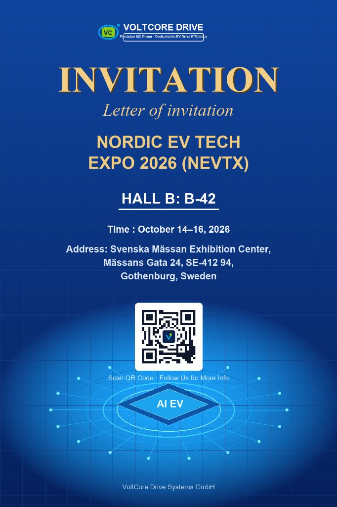
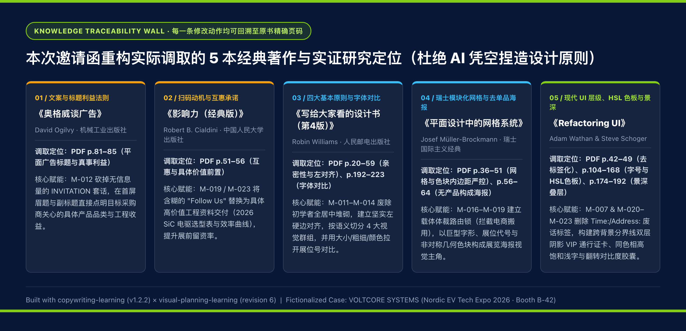
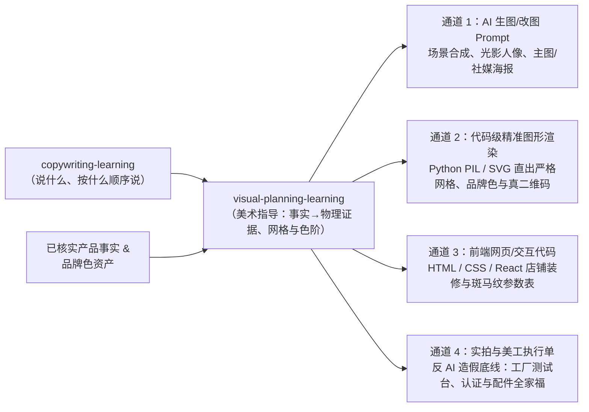

# visual-planning-learning · 视觉策划与案例学习技能包

[English README](README.md) · [实战对比演示](#实战演示双技能重做一张-b2b-展会邀请函) · [工作原理与四通道](#工作原理一个美术指导大脑--四条落地通道) · [面向人群](#面向人群who-is-this-for) · [知识库全景](#知识库全景概览-catalogjson-r10) · [快速上手](#快速上手)

## 告别 AI 生图与排版的“抽盲盒”：给 Agent 装上一位有眼动实证与经典原著撑腰的美术指导

`visual-planning-learning` **不是**一个帮生图模型扩写“高级感、科技感”的 Prompt 工具，而是一位上游**美术指导 / 视觉总导演（Art Director）**。它先基于已核实的产品事实与真实案例，决定**画面该演什么物理证据、网格和色阶怎么排、哪些视觉噪音必须砍掉**，再按交付物性质精准分流到 **4 条下游落地通道**（AI 生图 Prompt、Python/SVG 代码级像素直出、HTML/React 前端代码、或反 AI 造假的实拍执行单）。

**v1.3.0 · `catalog.json` `r10` · 15 项全量核验信源 · 28 条可检索视觉方法（`M-001`–`M-028`） · 23 篇中英双语案例卡**

[浏览中文案例索引](library/README.md) · [English Library Index](library/README.en.md) · [结构化双语目录](library/catalog.json) · [搭配 `copywriting-learning` 联动](https://github.com/XavierCrea/copywriting-learning)

---

## 实战演示：双技能重做一张 B2B 展会邀请函

以下展示同一份虚构 B2B 业务输入（*VoltCore Drive Systems GmbH* · 2026 瑞典哥德堡北欧电动车技术展 · 展位 `Booth B-42` · 48V–800V SiC 牵引逆变器），在 **“传统一句话 Prompt 抽盲盒”** 与 **“`copywriting-learning` × `visual-planning-learning` 双技能协同重构”** 下的真实产出对比：

### 首屏直观对比：Before vs. After（综合胜出主推稿）

| 改造前（Before · 传统居中科技风模板） | 改造后（After · 方案 B 品牌蓝跨界叠层通行证版） |
| :---: | :---: |
|  |  |
| **最大字号给空洞的 `INVITATION`、全居中无左硬边、没写清卖什么产品、底部发光 `AI EV` 芯片抢二维码视线。** | **1 秒锁定展会与 SiC 逆变器品类、悬浮白卡锁死 `Booth B-42`、明确扫码领 2026 选型手册、无缝承接 Logo 品牌三色。** |

---

### 完整五步重构全记录（2560px 超清拆解）




<details>
<summary>展开查看“一源三构” 3 套成稿高清原图并排对比 & 复现 Prompt</summary>

| 方案 B · 品牌蓝跨界叠层通行证（综合胜出主推） | 流派 A · 瑞士非对称网格版 | 流派 C · 工业暗黑建筑网格版 |
| :---: | :---: | :---: |
|  |  |  |

```text
请联合调用 copywriting-learning 和 visual-planning-learning，帮我重构一张 2:3 竖版 B2B 展会邀请函：
- 已知产品与事实：[48V–800V SiC 牵引逆变器、99.1% 峰值效率、ISO 26262 ASIL-D]
- 展会信息：[Nordic EV Tech Expo 2026，2026年10月14–16日，Hall B · Booth B-42，瑞典哥德堡 Svenska Mässan]
- 品牌 Logo 既有色：[深海钴蓝 #0C224E、电弧青蓝 #00A3E0、高能脉冲绿 #84CC16]
- 扫码交付物：[下载 2026 SiC 电驱选型手册与引脚矩阵]
要求：先诊断原稿问题，检查体裁路由（M-019），并基于知识库方法给出 2–3 套不同流派的视觉构图方案。
```

</details>

---

## 工作原理：一个美术指导大脑 → 四条落地通道

### 1. 上游视觉决策 × 四条下游执行通道



| 下游落地通道 | 适用交付物 | 为什么必须走这条通道 |
| :--- | :--- | :--- |
| **通道 1 · AI 生图 / 改图 Prompt** | 真实场景合成、光影氛围、电商主图与社媒配图 | 先由本技能锁死买家决策证据、1:1 比例参照物（`M-001`）与构图重心，再交由生图提示词编译，告别盲抽。 |
| **通道 2 · 代码级精准渲染（Python PIL / SVG）** | 展会邀请函、瑞士网格海报、停车场纯色大牌、对比长图 | **专治 AI 生图 4 大硬伤**：严格模数网格对齐（`M-016`）、锁死精确品牌 HEX 色值、零拼写错误小字排版、100% 可扫描真二维码（支持“AI 铺底图 + 脚本压字嵌码”混合管线）。 |
| **通道 3 · 响应式网页代码（HTML / CSS / React）** | 阿里国际站装修、独立站着陆页、可交互选型表与参数表 | 至少一半的经典 UX 规则——单栏语义分组斑马纹参数表（`M-005`）、弃用横向 Tab 改纵向展开 + Sticky 目录（`M-006`）、无边框留白（`M-007`）——必须用前端代码落地，而非整页切大图。 |
| **通道 4 · 实拍与美工执行单** | 工厂老化测试台、UL/CE 证书证据、随箱线束配件全家福（`M-003`） | **B2B 反 AI 造假底线**：严禁让 AI 凭空捏造硬件内部构造、测试曲线或资质证书；直接输出去形容词化的机位、参照物与引线标注执行单。 |

### 2. 线下到线上全链路：`100m → 10m → 1m` 跨视距空间接力

针对线下展会与核心商圈场景，本技能结合布罗克曼三维展位法则（`M-019`）与小米 SU7 巨幕实战拆解（`M-028`），按观众移动距离切分信息密度：

| 视距 | 典型触点 | 视觉与排版策略 | 必须果断砍掉的噪音 |
| :--- | :--- | :--- | :--- |
| **`100m` 远距截停** | 展馆停车场大牌 / 商圈外立面巨幕（`M-028`） | 1.5 秒扫视：`≥75%` 单一高纯度品牌色场切开环境噪点 + 品类/情绪记忆钩子 + 放大 6 倍的展位号（`BOOTH #XXXX`） | 参数表、多宫格价格、底部小字、二维码 |
| **`10m` 中距引流** | 展位门楣 / `170cm` 视平线主背板（`M-019`） | 锁死与 `100m` 巨幕完全一致的品牌主色形成跨空间认知识别，把核心主张与主推方案锚定在 `170cm` 站立视平线上下 | 被人群或前台挡住的底部小字 |
| **`1m` 近距成交** | 展台实物陈列 / 桌面选型表 / 线上 PDP（`M-001`–`M-005`、`M-020`） | 用比例参照图、引线标注、单栏斑马纹参数表与真实认证证据完成硬核技术买家收口 | 没有事实依据的空泛口号 |

---

## 面向人群（Who Is This For）

| 人群角色 | 常见真实痛点 | 怎么用 `visual-planning-learning` | 常用落地通道 |
| :--- | :--- | :--- | :--- |
| **跨境电商 / B2B 外贸运营与老板**<br>*（阿里国际站 / Amazon / 独立站）* | 详情页密密麻麻像一堵墙、买家看不出尺寸和是否含配件、不知道该让摄影师拍什么，又怕 AI 瞎编产品结构与认证。 | 输出分屏 PDP 分镜脚本（`M-001`–`M-006`）、工厂实拍与配件全家福清单、单栏斑马纹参数表网页代码。 | 通道 1、3、4 |
| **品牌市场 / 展会活动负责人** | 展会邀请函、户外巨幕、展位背板各做各的，发出去像十年前的模板，或者在展馆外 100 米根本抓不住视线。 | 用“一源三构”出多流派邀请函（品牌色锁定 vs 瑞士网格），并统筹 `100m → 10m → 1m` 跨视距触点接力。 | 通道 2、4 |
| **设计师 / 美工 / 视觉策划** | 最怕听见“再大气一点、再有科技感一点”这类玄学改稿意见，反复返工却缺少客观说服依据。 | 用 Baymard 眼动实证、布罗克曼网格与 *Refactoring UI* 原书页码撑腰，快速给出 2–3 套有理有据的构图提案。 | 通道 1、2、4 |
| **独立开发者 / 产品经理 / 增长运营** | 没有专职设计师，自己搭的着陆页首屏、定价锚定页、参数对比表总是显得杂乱或抓不住重点。 | 用 *Don't Make Me Think*（`M-024`–`M-027`）清理页面视觉噪音，直接产出干净的 HTML/CSS/React 布局规范。 | 通道 3 |
| **AI 工作流玩家 / Agent Skill 开发者** | 静态提示词越写越长，却无法在一次次真实改稿和街头观察中沉淀可复用的经验。 | 复用 `learning_origin` 四层溯源 + `apply-patch` 原子进化机制，把实战复盘（如 `F-001`、小米 SU7 拆解）持续写进可检索双语知识库。 | 全通道 + CLI |

---

## 知识库全景概览 (`catalog.json` `r10`)

所有条目均通过 `learning_origin` 字段严格区分**经典原著典籍（`book_canon`）**、**外部实证基准（`benchmark_study`）**、**实战共创正反对比拆解（`co_dissected_teardown`）**与**任务实战反馈（`task_feedback`）**，检索时可通过 `--origin` 精准过滤：

| 信源类别 (`learning_origin`) | 已完整核阅的原始著作、实验与实战拆解（共 `15` 项，`100%` 全文/原图核验） | 提炼的视觉方法（`28` 条）与双语案例卡（`23` 中 + `23` 英） |
| :--- | :--- | :--- |
| **[实战共创] 街头实拍正反对比拆解 (`co_dissected_teardown`)** | **2026 新一代小米 SU7 × 舒淇「卡布里蓝」核心商圈巨幕 vs. 同行车企大屏（捷尼赛思/岚图泰山/腾势 N9/小鹏 X9/别克/吉利/阿维塔）**：由“三连追问”驱动的 6 维视觉与传播拆解 | `M-028`（`validated`）· `1` 篇中英双语案例卡（`C-xiaomi-su7-2026-mall-billboard-teardown`）+ `F-002` |
| **Baymard Institute 电商 UX 基准 (`benchmark_study`)** | `5` 篇大规模眼动与可用性报告：比例参照图（In-Scale）、图文引线标注（Descriptive Callouts）、标配与选配附件图、参数表可扫描性、弃用横向 Tab 导航 | `M-001`–`M-003`、`M-005`–`M-006` · `5` 篇中英双语案例卡（`C-baymard-*`） |
| **Marketing Examples (Harry Dry)** | `4` 组着陆页、定价与品牌改版拆解：Above the Fold 五要素、Rows 实时表格首屏翻倍实验与 Haako 改写、Refactoring UI `$149` 高配锚定与 Basecamp 比价、Tropicana 5500 万美元改版教训与 Angostura 超大酒标 | `M-004`、`M-009`–`M-010` · `4` 篇中英双语案例卡（`C-me-*`） |
| **Robin Williams《写给大家看的设计书（第 4 版）》** | 258 页全书核阅：CRAP 四大原则（亲密性、对齐、重复、对比）、12 色轮（暗色/亮色、色质抖动、冷退暖进面积比）、字体设计（协调/冲突/对比、`giraffe` 词形海岸线） | `M-011`–`M-015` · `3` 篇中英双语案例卡（`C-williams-*`） |
| **Josef Müller-Brockmann《平面设计中的网格系统》** | 85 页全书核阅：`1 : 1.5 : 2 : 3` 页边距递进、正文行高模数网格（`55行 = 4×13 + 3`）、`8/20/32` 格矩阵、色块内边距四图对照（Figs. 1–4）、瑞士无单品构成海报（*musica viva*）、B2B 工业品 30 格手册与三维展位 `170cm` 视平线网格 | `M-016`–`M-019` · `3` 篇中英双语案例卡（`C-muller-brockmann-*`） |
| **Adam Wathan & Steve Schoger《Refactoring UI》** | 252 页原书 + *7 Practical Tips*：字重色阶层级、深色背景同色相浅字、无边框分组、去冗余标签 vs. 参数表标签反强调、`6` 并 `4` 双层富表格、`≥25%` 非线性间距尺、`45–75` 字符行宽、`100–900` HSL 九阶色板与感知亮度色相旋转、翻转对比度过 WCAG `4.5:1`、双层阴影与背景照片单色正片叠底 | `M-007`–`M-008`、`M-020`–`M-023` · `4` 篇中英双语案例卡（`C-refactoring-ui-*`） |
| **Steve Krug《Don't Make Me Think, Revisited（第 3 版）》** | 257 页原书核阅：第一定律（*Don't make me think!*）、60 英里扫视与满意即止、广告牌法则 *Billboard Design 101*、视觉嵌套错位、`No cursor = no hover = no clue`、三大视觉噪音（咆哮/失序/杂乱）、第三定律（`103` → `34` 词两轮砍半）、双倍醒目 `"You are here"`、6 项后备箱测试（*Trunk Test*）、首屏大爆炸理论（`50ms`、`6–8` 词 Tagline vs. Motto、公地悲剧）与善意储蓄罐（真 FAQ vs. `QWWPWAs`、读屏用耳扫视） | `M-024`–`M-027` · `3` 篇中英双语案例卡（`C-krug-*`） |

---

## 快速上手

### 安装方式

将整个仓库克隆或下载到你的 Agent 技能目录中（保持 `SKILL.md`、`references/`、`library/`、`scripts/` 在同一目录内）：

- **Antigravity 全局安装：** `~/.gemini/config/skills/visual-planning-learning/`
- **项目级 / Codex 安装：** `.agents/skills/visual-planning-learning/`

内置检索脚本需要 Python 3.9+（仅依赖标准库，无需安装第三方包）。

### 快速检索与校验命令

在技能根目录（`visual-planning-learning/`）下运行：

```bash
# 1. 查看资料库规模与信源核阅状态
python3 scripts/library.py summary

# 2. 按视觉卡点症状、渠道或信源出身（--origin）加权检索
python3 scripts/library.py search "参数表 扫描" --kind methods
python3 scripts/library.py search "billboard visual noise" --kind cases
python3 scripts/library.py search "商圈 户外大屏 纯色场" --origin co_dissected_teardown

# 3. 单次批量调取多条方法与中英文案例卡
python3 scripts/library.py get M-001 M-019 M-028 C-xiaomi-su7-2026-mall-billboard-teardown

# 4. 校验 Schema、外键引用、中英文案例卡配对与 SHA-256 指纹
python3 scripts/library.py validate --check-files
```

### 与 `copywriting-learning` 组合联动

`visual-planning-learning` 既可独立使用，也可与 [`copywriting-learning`](https://github.com/XavierCrea/copywriting-learning) 深度联动：

- **[`copywriting-learning`](https://github.com/XavierCrea/copywriting-learning)** 决定**“说什么、按什么顺序说、用什么事实证据说服人”**；
- **`visual-planning-learning`** 决定**“画面演什么物理证据、元素如何在网格上分组对齐、该走哪条下游落地通道，以及 `100m → 10m → 1m` 线下到线上触点如何接力”**。
